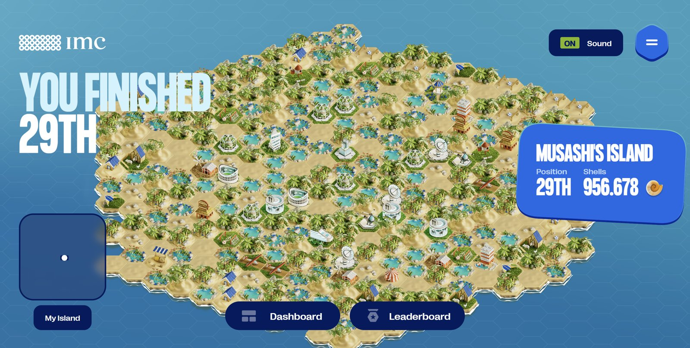

# 🏝️ Musashi's Island: IMC Prosperity 3

### 🏆 29th out of 12,620 teams worldwide · 🇫🇷 2nd in France

Our team's submission to **IMC Prosperity 3 (2025)**, IMC Trading's 15-day global algorithmic and manual trading competition. Each round adds new products to trade on a simulated exchange. Our Python bot posts orders against the order book every tick, under strict position limits.

> *"You must understand that there is more than one path to the top of the mountain."* (Miyamoto Musashi)

<p align="center">
  
</p>

## 📈 Results

| Leaderboard | Rank |
|---|---|
| **Overall** | **#29** / 12,620 teams |
| Algorithmic | #33 |
| Manual | #112 |
| France | **#2** |

Final PnL: **956,678 SeaShells**.

## 🧠 Strategies at a glance

| Product family | Approach |
|---|---|
| `RAINFOREST_RESIN` | Market making around a fixed fair value (10,000), with spreads that adapt to order-book depth |
| `KELP` | Mean reversion on a fair value from the filtered order book, with filters against adverse selection |
| `SQUID_INK` | SMA plus mean reversion triggered by volatility, with aggressiveness that adjusts to the market |
| `PICNIC_BASKET1/2`, `CROISSANTS`, `JAMS`, `DJEMBES` | Statistical arbitrage of each basket against its synthetic replica, using z-scores of the spread |
| `VOLCANIC_ROCK` + vouchers | Black–Scholes implied volatility, trading the IV smile, delta hedging |
| `MAGNIFICENT_MACARONS` | Arbitrage between islands, net of transport fees, tariffs and conversion limits |
| Manual rounds | Brute-force search for the best currency-conversion path (R1); a convex portfolio optimisation with `cvxpy` on news sentiment (R5) |

## 🗂️ Repository structure

```
├── round_1/ … round_5/     # final algorithm submitted each round (+ manual-round solvers)
│   └── roundX_final.py     # the Trader class uploaded to the Prosperity platform
├── research/               # Jupyter notebooks used to find the signals
│   ├── rounds_1_2_analysis.ipynb
│   ├── baskets_croissants_jams.ipynb
│   ├── volcanic_rock_vouchers.ipynb
│   ├── round_3_hint.ipynb
│   ├── round_5_analysis.ipynb
│   └── trades_round5_analysis.ipynb
├── data/                   # price, trade & observation data released for each round
└── assets/
```

`round_5/round5_final.py` is the complete final bot. It combines every strategy above in one `Trader` class.

## 🛠️ Usage

```bash
git clone https://github.com/julesFrealle/prosperity3.git
cd prosperity3
pip install prosperity3bt          # community backtester
prosperity3bt round_5/round5_final.py 5
```

Open the notebooks in `research/` with Jupyter. They read their data from `../data/`.

## 📖 Round-by-round strategy

### 1️⃣ Round 1

<details>
<summary><b>Round 1 — New Products and Strategy Overview</b></summary>

#### 📦 New Products
- **RAINFOREST_RESIN**: Stable commodity with predictable market behavior.
- **KELP**: Volatile asset showing strong mean-reversion tendencies.
- **SQUID_INK**: Extremely volatile asset characterized by sharp short-term trends.

#### 🛠️ Our Strategy
- **RAINFOREST_RESIN**: Used fixed fair-value market-making around 10,000. Implemented dynamic bid and ask spread adjustments based on live order-book data to manage risk and optimize trades.
- **KELP**: Deployed a mean-reversion strategy with a dynamic fair-value calculation based on order-book depth filtering. Safeguards were implemented to reduce adverse selection from large volume orders.
- **SQUID_INK**: Combined SMA (Simple Moving Averages) with volatility-triggered mean-reversion. Adapted trade aggressiveness dynamically based on short-term volatility and market conditions.

</details>

### 2️⃣ Round 2

<details>
<summary><b>Round 2 — Basket Strategies and Enhancements</b></summary>

#### 📦 New Products
- **CROISSANTS vs JAMS**: Statistical spread trading.
- **PICNIC_BASKET1 & PICNIC_BASKET2 vs DJEMBES**: Synthetic basket arbitrage.

#### 🛠️ Our Strategy
- Developed a z-score-based trading system for both basket strategies, triggering trades dynamically based on statistically significant spread deviations.

#### ✨ Changes to Existing Products
- **RAINFOREST_RESIN**: Refined market-making spreads for faster reaction to order-book shifts.
- **KELP**: Enhanced mean-reversion beta values and tightened adverse volume filtering.
- **SQUID_INK**: Improved volatility indicators and dynamic adjustments for better trend capture.

</details>

### 3️⃣ Round 3

<details>
<summary><b>Round 3 — Volatility Trading Introduction</b></summary>

#### 📦 New Products
- **VOLCANIC_ROCK & Vouchers**: Complex derivatives requiring advanced volatility modeling.

#### 🛠️ Our Strategy
- Built a robust volatility trading system utilizing the Black-Scholes model for implied volatility calculation. Implemented dynamic delta-neutral hedging to reduce exposure and optimize returns.

#### ✨ Changes to Existing Products
- Fine-tuned trading parameters across RAINFOREST_RESIN, KELP, SQUID_INK, and basket strategies for enhanced responsiveness and precision.

</details>

### 4️⃣ Round 4

<details>
<summary><b>Round 4 — Macaron Arbitrage</b></summary>

#### 📦 New Products
- **MAGNIFICENT_MACARONS**: Inter-island arbitrage opportunities.

#### 🛠️ Our Strategy
- Aggressively pursued arbitrage opportunities when transport, tariff, and conversion costs allowed profitable inter-island trades.

#### ✨ Changes to Existing Products
- Conducted further refinements on market-making parameters, volatility thresholds, and basket spread management strategies, significantly enhancing overall performance and risk management.

</details>

### 5️⃣ Round 5

<details>
<summary><b>Round 5 — Final Integrated Strategy</b></summary>

#### 🛠️ Our Final Strategy
- Unified all previously developed strategies into a cohesive, integrated trading system. Enhanced market-making, sophisticated mean-reversion trading, advanced basket arbitrages, volatility-driven options trading, and macaron arbitrage were all executed simultaneously with optimized coordination.

#### ✨ Final Adjustments
- Implemented comprehensive, real-time risk management and advanced position-sizing algorithms across the entire product portfolio, achieving maximum responsiveness and profitability.

</details>

---

## 👨‍👩‍👧‍👦 Team

Five students from the Bachelor of Science at **École Polytechnique**:

- **Jules Fréalle**: [GitHub](https://github.com/julesFrealle) · [LinkedIn](https://www.linkedin.com/in/jules-frealle/)
- **Emeric Payer**: [GitHub](https://github.com/emeric7287) · [LinkedIn](https://www.linkedin.com/in/emeric-payer-754413265/)
- **Youssef Nakhla**: [GitHub](https://github.com/YoussefNakhla) · [LinkedIn](https://www.linkedin.com/in/youssef-nakhla-43963126b/)
- **Mael Kupperschmitt**: [GitHub](https://github.com/maelkupp) · [LinkedIn](https://www.linkedin.com/in/mael-kupperschmitt-84b40b294/)
- **Iyad El Khoury**: [GitHub](https://github.com/danido05)

> *"From one thing, know ten thousand things."* (Team MUSASHI)
